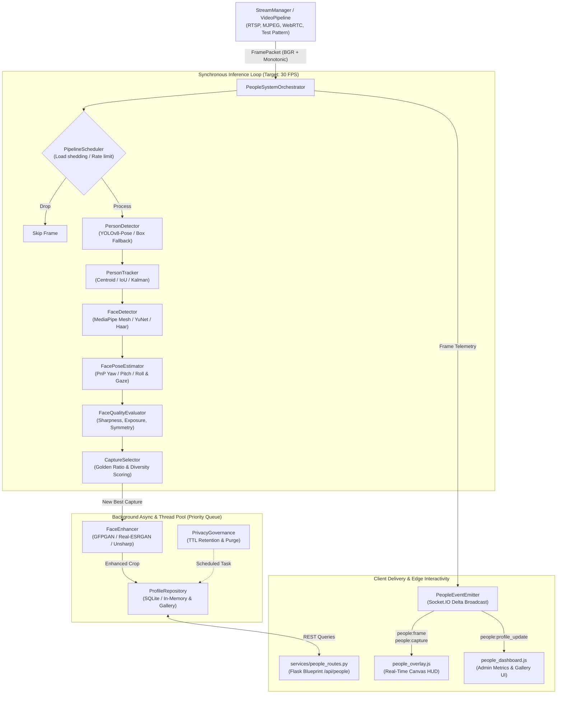

# Real-Time Multi-Person Facial Capture System — Operator & Architecture Guide

## 1. Architectural Overview

The **Real-Time Multi-Person Facial Capture System** is an enterprise-grade vision pipeline engineered for Flask and WebRTC/MJPEG streaming infrastructure. It provides continuous tracking of individuals across video frames, detects facial landmarks and 3D head poses, scores instantaneous facial quality, captures optimal candidate crops ("best captures"), performs asynchronous super-resolution enhancement, stores profile galleries with privacy compliance, and broadcasts real-time telemetry to browser clients via WebSockets and REST APIs.



---

## 2. Subsystem Components & Responsibilities

### 2.1. Ingestion & Preprocessing
- **`VideoPipeline` & `StreamManager`** (`outputs/services/video_pipeline.py`, `outputs/services/stream_manager.py`):
  Handles camera acquisition, resolution scaling, test-pattern generation, and non-blocking delivery of decoded frames. Packets arrive with strict monotonically increasing timestamps, sequence identifiers, and epoch counters.

### 2.2. Human Detection & Tracking
- **`PersonDetector`** (`outputs/services/person_detector.py`):
  Employs Ultralytics YOLOv8-pose with OpenCV fallback to detect full-body bounding boxes and skeletal keypoints.
- **`PersonTracker`** (`outputs/services/person_tracker.py`):
  Maintains persistent identity tracks across frame boundaries using combined spatial IoU distance, centroid motion projection, and Kalman state prediction. Tracks transition through `TENTATIVE`, `CONFIRMED`, `COASTING`, and `DELETED` lifecycle states.

### 2.3. Face Detection & Pose Estimation
- **`FaceDetector`** (`outputs/services/face_detector.py`):
  Extracts 68/468 facial landmark coordinates, 5-point alignment keypoints, and precise face bounding boxes mapped to parent person tracks.
- **`FacePoseEstimator`** (`outputs/services/face_pose.py`):
  Solves the Perspective-n-Point (PnP) problem against a canonical 3D facial model to calculate Euler angles (yaw, pitch, roll) and gaze vectors. Evaluates motion blur and angular deviation from frontal alignment.

### 2.4. Quality Evaluation & Intelligent Capture Selection
- **`FaceQualityEvaluator`** (`outputs/services/face_quality.py`):
  Computes a composite normalized score ($Q \in [0.0, 1.0]$) weighing:
  - Laplacian variance sharpness
  - Luminance balance and exposure histogram
  - Facial symmetry around the nasal bridge
  - Frontal pose alignment penalty
  - Minimum size and resolution adequacy
- **`CaptureSelector`** (`outputs/services/capture_selector.py`):
  Maintains a diversity buffer per active track. Enforces cooldown intervals between captures, compares candidate quality against historical bests, and selects the golden facial capture when an individual turns toward the camera.

### 2.5. Enhancement & Super-Resolution
- **`FaceEnhancer`** (`outputs/services/face_enhancer.py`):
  Offloads heavy super-resolution computation to an asynchronous background worker pool (`ThreadPoolExecutor`). Supports GFPGAN, Real-ESRGAN, or an algorithmic unsharp-mask/bicubic pipeline when neural runtimes are absent.

### 2.6. Profile Persistence & Privacy Governance
- **`ProfileRepository`** (`outputs/services/profile_repository.py`):
  Thread-safe storage engine persisting person profiles, biometric feature vectors, and full-resolution cropped facial images to SQLite and filesystem storage.
- **`PrivacyGovernance`** (`outputs/services/privacy_governance.py`):
  Enforces regulatory privacy controls (GDPR / CCPA). Manages time-to-live (TTL) retention timers, automatic data redaction, reversible blurring, and complete identity purging.

### 2.7. Event Broadcasting & Scheduling
- **`PeopleEventEmitter`** (`outputs/services/people_events.py`):
  Transmits optimized binary and JSON WebSocket packets to frontend clients with client-room throttling and delta encoding.
- **`PipelineScheduler`** (`outputs/services/pipeline_scheduler.py`):
  Monitors processing latency. Dynamically sheds frames or reduces inference frequency during CPU/GPU thermal spikes or frame backlog.
- **`AnalysisLifecycleController`** (`outputs/services/analysis_lifecycle.py`):
  Provides administrative control over the analysis state machine (`IDLE`, `RUNNING`, `PAUSED`, `STOPPED`).

### 2.8. Central Orchestration
- **`PeopleSystemOrchestrator`** (`outputs/services/people_orchestrator.py`):
  Assembles all twelve subcomponents into an integrated processing loop. Operates in two modes:
  1. **Autonomous Worker Mode**: Spawns an internal background thread reading directly from `StreamManager.frames.latest`.
  2. **Push Mode**: Exposes `process_frame(packet)` for direct caller-driven ingestion.

---

## 3. Data Contracts (`outputs/services/face_contracts.py`)

All subsystem interfaces adhere to immutable or type-checked dataclasses:

| Class | Description | Key Attributes |
| :--- | :--- | :--- |
| `BoundingBox` | Spatial rectangular box | `x1, y1, x2, y2, confidence, label` |
| `PersonTrack` | Associated person track | `track_id, bbox, state, first_seen, last_seen, velocity` |
| `FaceObservation` | Face detection instance | `face_id, track_id, bbox, landmarks, face_crop, confidence` |
| `HeadPose` | 3D angular orientation | `yaw, pitch, roll, gaze_vector` |
| `QualityBreakdown`| Multi-factor quality metric | `sharpness, brightness, symmetry, pose_score, composite_score` |
| `CaptureCard` | Selected best facial crop | `capture_id, track_id, timestamp, crop_image, quality_score, is_enhanced` |
| `PersonProfile` | Aggregated person profile | `profile_id, track_ids, best_captures, total_sightings, created_at` |
| `PeopleSystemState` | Global system status snapshot | `lifecycle_state, active_tracks, total_profiles, current_fps, dropped_frames` |

---

## 4. REST API Reference

The system mounts the `people_bp` blueprint under `/api/people`.

### 4.1. System & Tracking Endpoints
- **`GET /api/people/status`**
  - Returns: System state, active track count, profile count, pipeline FPS, and dropped frames.
  - Response:
    ```json
    {
      "lifecycle_state": "RUNNING",
      "active_tracks": 2,
      "total_profiles": 14,
      "current_fps": 28.5,
      "dropped_frames": 0,
      "scheduler_mode": "NORMAL"
    }
    ```

- **`GET /api/people/tracks`**
  - Returns: List of currently tracked persons in the active scene with bounding boxes, facial landmarks, and pose angles.

### 4.2. Profile & Capture Endpoints
- **`GET /api/people/profiles`**
  - Parameters: `limit` (int, default 50), `offset` (int, default 0), `state` (active|archived).
  - Returns: Paginated list of registered person profiles.

- **`GET /api/people/profiles/<profile_id>`**
  - Returns: Profile metadata, capture timestamps, and thumbnail URLs.

- **`GET /api/people/profiles/<profile_id>/gallery`**
  - Returns: Array of all captured facial crops for the specified profile.

- **`GET /api/people/profiles/<profile_id>/best`**
  - Returns: Highest quality facial capture (enhanced if available) as an image binary or metadata JSON.

- **`POST /api/people/profiles/<profile_id>/anonymize`**
  - Action: Irreversibly obfuscates/blurs biometric assets associated with the profile.

- **`DELETE /api/people/profiles/<profile_id>`**
  - Action: Permanently removes profile record, biometric embeddings, and image files.

### 4.3. Pipeline Control Endpoints
- **`POST /api/people/control/lifecycle`**
  - Body: `{"action": "start" | "pause" | "resume" | "stop" | "reset"}`
  - Modifies pipeline processing state.

- **`POST /api/people/control/config`**
  - Body: JSON object of runtime-tunable parameters (e.g., `{"min_quality_threshold": 0.65, "enhancement_enabled": true}`).

- **`POST /api/people/purge`**
  - Body: `{"older_than_seconds": 86400, "unconfirmed_only": false}`
  - Manually triggers privacy retention cleanup.

---

## 5. WebSocket Event Catalog (Socket.IO)

Clients connect to Flask-SocketIO using standard transports (`websocket`, `polling`). The server emits real-time events to the `people_stream` room:

| Event Name | Direction | Payload Description | Frequency |
| :--- | :--- | :--- | :--- |
| `people:frame` | Server $\to$ Client | Active tracks, bounding boxes, landmarks, head pose needles | Per processed frame (~30 Hz) |
| `people:capture` | Server $\to$ Client | New high-quality facial capture event + thumbnail data URI | Event-driven (on new best capture) |
| `people:profile_update` | Server $\to$ Client | Profile identity aggregation, merged tracks | Event-driven |
| `people:enhancement_ready`| Server $\to$ Client | Enhanced super-resolution image ready notification | Async callback (background pool) |
| `people:state` | Server $\to$ Client | Lifecycle state transition (`RUNNING`, `PAUSED`, `SHUTDOWN`) | State changes & heartbeat (1 Hz) |

---

## 6. Frontend Integration

Two production JavaScript modules are provided in `outputs/static/js/`:

### 6.1. HUD Canvas Overlay (`people_overlay.js`)
- Mounts directly over any `<video>` or `` element displaying the camera feed.
- Draws smooth, interpolated bounding boxes for tracked individuals.
- Renders 5-point and 68-point facial landmark meshes.
- Projects a 3D head pose orientation needle (pitch/yaw direction vector).
- Displays animated "Capture Flash" rings when a golden ratio capture is triggered.

```javascript
// Initialization example
const canvas = document.getElementById("hudCanvas");
const socket = io();
const overlay = new PeopleOverlay(canvas, {
  drawLandmarks: true,
  drawPoseNeedle: true,
  drawTrackId: true,
  flashOnCapture: true
});
socket.on("people:frame", data => overlay.renderFrame(data));
socket.on("people:capture", data => overlay.triggerCaptureEffect(data));
```

### 6.2. Administrative Dashboard (`people_dashboard.js`)
- Real-time KPI widgets: FPS, active tracks, captured faces, load shed percentage.
- Live-updating profile gallery grid with card flip for quality metric breakdown.
- Lifecycle state control toolbar (Play, Pause, Reset, Purge).
- Privacy compliance modal with one-click anonymization and GDPR deletion.

---

## 7. Configuration & Environment Variables

| Variable / Parameter | Default | Purpose |
| :--- | :--- | :--- |
| `PEOPLE_DETECTOR_MODEL` | `yolov8n-pose.pt` | Path or model name for person detection |
| `PEOPLE_FACE_MODEL` | `yunet` | Face detector backend (`yunet`, `mediapipe`, `haar`) |
| `PEOPLE_ENHANCEMENT_ENABLED` | `true` | Enable async super-resolution (GFPGAN / unsharp) |
| `PEOPLE_MIN_QUALITY_SCORE` | `0.60` | Minimum composite score to register a capture |
| `PEOPLE_CAPTURE_COOLDOWN_SEC` | `2.5` | Minimum seconds between captures for a single track |
| `PEOPLE_RETENTION_HOURS` | `24` | Privacy TTL before automated purge |
| `PEOPLE_MAX_WORKERS` | `4` | Thread pool concurrency for enhancement workers |

---

## 8. Deployment & Operational Verification

### 8.1. Running Unit & Integration Tests
Execute the comprehensive test suite to verify pipeline functionality across all subsystems:
```powershell
# Run the complete test suite
c:\Users\dhanu\Documents\Codex\2026-10-22\t\work\video-runtime\Scripts\python.exe -m pytest outputs/tests

# Run specifically the orchestrator and integration suites
c:\Users\dhanu\Documents\Codex\2026-10-22\t\work\video-runtime\Scripts\python.exe -m pytest outputs/tests/test_people_orchestrator.py outputs/tests/test_people_system_integration.py
```

### 8.2. Starting the Application
```powershell
cd c:\Users\dhanu\Documents\Codex\2026-10-22\t\outputs
..\work\video-runtime\Scripts\python.exe app.py
```
Access the application at `http://127.0.0.1:5000/`. The people dashboard is available at `/people` or via API endpoints at `/api/people/status`.

### 8.3. Troubleshooting & Diagnostics
- **High CPU / Latency Drop**: Ensure `PipelineScheduler` load-shedding is enabled (`adaptive_framerate: true`). The system will drop intermediate pose evaluations while keeping tracks active.
- **Missing Face Crops**: Verify `FaceDetectorConfig.extract_face_crops = True` so facial bounding boxes are sliced for quality assessment.
- **CSRF Rejections on API Calls**: REST API endpoints under `/api/people/` support server-to-server operations and do not require session CSRF tokens when requested with `Content-Type: application/json`. Interactive frontend forms pass the standard `X-CSRF-Token` header.
